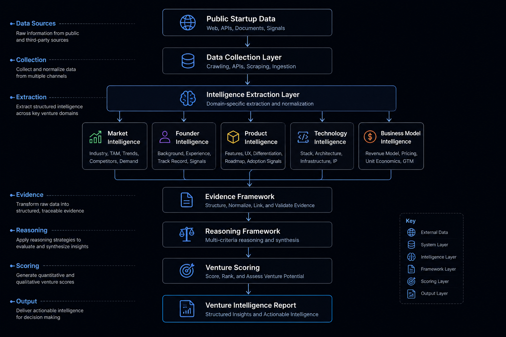

# System Architecture
<p align="center">
  
</p>

## Overview

Predictron Engine is a modular venture intelligence system designed to transform publicly available startup information into structured, explainable intelligence.

Rather than relying on a single prediction model, the engine decomposes startup analysis into independent intelligence domains. Each domain extracts structured signals that are aggregated into evidence, reasoned over, and synthesized into a comprehensive venture intelligence report.

The architecture emphasizes explainability, deterministic extraction, modularity, and continuous evaluation.

---

## High-Level Architecture

```text
Public Startup Data
        │
        ▼
Collection + Website Evidence Collection
        │
        ▼
Extraction
 ├── Company / Market / Founder
 ├── Product / Technology / Business Model
 └── Traction / Competition / Risk / Metadata
        │
        ▼
Evidence Gathering (knowledge providers)
        │
        ▼
Reasoning (observations)
        │
        ▼
Evaluation (dimension assessments) ──► Scoring
        │
        ▼
Recommendation + Confidence
        │
        ▼
Investment Decision
        │
        ▼
Calibration ──► Decision Synthesis
        │
        ▼
Report Generation
```

---

## Core Components

### Data Collection

Predictron Engine begins by collecting publicly available startup information, including company websites, product descriptions, documentation, and other structured sources.

The objective of this stage is to normalize raw startup information before downstream analysis.

---

### Intelligence Extraction

Instead of treating startup information as unstructured text, the engine organizes knowledge into specialized intelligence domains.

Current extraction modules include (each a single-responsibility extractor
composed by the `CompositeExtractor`, then enriched by deterministic
derived-metric inference):

- Company
- Market
- Founder
- Product
- Technology
- Business Model
- Traction
- Competition
- Risk
- Metadata

Each module produces structured features that can be independently validated, benchmarked, and extended without affecting the remainder of the system.
Evaluation
---

Scoring
### Evidence Framework

Recommendations
Extracted features are transformed into structured evidence.

Confidence
The Evidence Framework maintains traceability between raw observations and downstream reasoning, allowing every significant conclusion to be supported by observable evidence rather than opaque inference.

Report Generation

### Reasoning Framework

The Reasoning Framework synthesizes evidence across intelligence domains.

Rather than evaluating isolated signals, it considers relationships between market, founders, product, technology, and business model to generate coherent venture intelligence.

This separation between evidence generation and reasoning improves transparency, maintainability, and future extensibility.

---

### Venture Scoring

Structured evidence contributes to multiple evaluation dimensions.

Scores are intended to support decision-making by summarizing evidence across the venture, while preserving the underlying reasoning that produced each assessment.

---

### Report Generation

The final stage produces structured venture intelligence reports containing:

- Intelligence summaries
- Supporting evidence
- Venture scores
- Confidence indicators
- Key observations

The generated report is designed to be explainable, reproducible, and suitable for further human review.

---

## Architectural Principles

Predictron Engine is built around five engineering principles:

- Explainability
- Modular architecture
- Deterministic extraction
- Structured reasoning
- Continuous evaluation

These principles allow individual components to evolve independently while preserving transparency, reproducibility, and engineering rigor across the system.

### Canonical hashing (enforced)

Determinism is only real if two subsystems that encode the same fact
compute the same digest. The repository therefore treats every
content-addressed identifier as belonging to a single module:

> Every content-addressed identifier produced anywhere in the repository
> must ultimately be computed through `predictron_engine.canonical`. No
> module may implement content hashing or canonical JSON serialization on
> its own. A new digest helper must be a thin wrapper that delegates, not
> a reimplementation.

Use `content_digest` for a structure, `text_digest` for a string you have
already encoded, and `canonical_json` when you need the bytes themselves.

This exists because the codebase once had eleven compact-canonical call
sites speaking three dialects at three digest widths. Nothing about that
looked wrong to a reader — each site was a reasonable `hashlib.sha256`
over `json.dumps(..., sort_keys=True)`. The failure was invisible: two
subsystems encoding one logical fact produced two different digests, and
only a replay run comparing them would ever notice.

Two encoding details are load-bearing rather than cosmetic:

- **`ensure_ascii=True`.** `ensure_ascii=False` yields different bytes for
  the same content as soon as a payload contains a non-ASCII character.
  Two predictions differing only in an accented `company_name` would hash
  incompatibly with every other canonical id in the engine.
- **No `default=` fallback.** An earlier helper passed `default=str`,
  which silently stringified a `datetime` into the digest instead of
  raising. A digest that accepts a lossy encoding of its input is worse
  than one that refuses, because the persisted bytes and the hashed bytes
  can then disagree with no error anywhere. A non-JSON-native payload
  now raises `TypeError`.

#### Enforcement

`tools/check_canonical_invariant.py` fails the build when a new direct
content-hash implementation appears outside the approved low-level
modules. It is an AST check, not a grep, and runs in CI alongside ruff
and mypy:

```bash
python -m tools.check_canonical_invariant          # exit 1 on findings
python -m tools.check_canonical_invariant --list   # list, always exit 0
```

The rules flag `hashlib` constructors, `.hexdigest()`, the built-in
`salted hash()`, compact `json.dumps(sort_keys=..., separators=...)`,
and any digest-named helper that hashes without delegating.

Exemptions require a documented architectural justification, an explicit
suppression with a reason, and reviewer approval. A suppression without a
written reason is itself a build failure — the reason is the part a
reviewer actually needs to read. There is currently exactly one, for
`predictron_engine/dataset/acquisition/state.py:compute_file_hash`, which
digests raw file bytes for change detection rather than the canonical
encoding of a structure.

Two categories are deliberately not flagged: `tests/`, which reconstruct
the legacy expressions in order to assert the new helpers reproduce them
byte-for-byte, and `indent=2` pretty-printed reports, which are
human-readable documents rather than encodings that feed a digest.

The remaining non-negotiable rules — replay determinism, protocol
boundaries, evidence/provenance/trust separation, strict typing, and
versioned persisted artifacts — are catalogued with their rationale in
[CONTRIBUTING.md](../CONTRIBUTING.md#architectural-invariants).

These invariants may only be **strengthened or clarified**. Relaxing or
removing one requires an Architecture Decision Record covering its
motivation, the alternatives considered, the migration strategy, the
compatibility impact, and why the previous invariant no longer applies
— see [`docs/adr/`](adr/README.md). Technical enforcement tells you a
rule is forbidden; an ADR is where the cost of stopping forbidding it
gets a permanent, reviewable answer.
